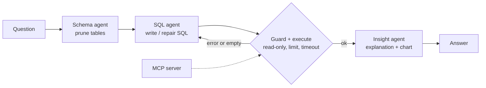

# 📊 Ask-My-Business

**A text-to-SQL analyst agent.** Ask a business question in plain English; a team of agents finds the right tables, writes SQL, validates and runs it safely, repairs its own mistakes, then returns the answer with a chart and a plain-language explanation. The same database tools are exposed through an **MCP server**.

## Architecture



| Component | File | Job |
|---|---|---|
| Schema agent | `askbiz/agents/schema_agent.py` | Picks relevant tables (schema pruning) |
| SQL agent | `askbiz/agents/sql_agent.py` | Generates SQL; on retries sees the previous SQL + error |
| Guard | `askbiz/guard.py` | SELECT-only, single statement, no system tables, auto LIMIT |
| DB layer | `askbiz/db.py` | Read-only connection, query timeout |
| Insight agent | `askbiz/agents/insight_agent.py` | Business explanation + chart spec |
| Graph | `askbiz/graph.py` | LangGraph wiring, repair loop, latency/token/cost logging |
| MCP server | `askbiz/mcp_server.py` | `list_tables`, `get_schema`, `run_query`, `make_chart` |
| API / UI | `askbiz/api.py`, `app.py` | FastAPI + Streamlit chat |

**Safety is layered:** prompt rules → guard → read-only DB connection → row limit → timeout. The business definitions (revenue, profit, "delivered only") live in `config.BUSINESS_RULES` (a small semantic layer).

## Quick start

```bash
python -m venv .venv
.venv\Scripts\activate            # macOS/Linux: source .venv/bin/activate
pip install -r requirements.txt
copy .env.example .env            # add ANTHROPIC_API_KEY or GEMINI_API_KEY
python scripts/load_data.py       # builds data/business.db (synthetic sales data)
streamlit run app.py              # chat UI
uvicorn askbiz.api:app --reload   # REST API  -> POST /ask
python -m askbiz.mcp_server       # MCP server (stdio)
pytest                            # 34 tests, no API key or internet needed
```

Use a real dataset (Olist, Superstore, Northwind) by loading it into SQLite/Postgres, setting `DATABASE_URL`, and rewriting `BUSINESS_RULES`.

## Evaluation

`python scripts/run_eval.py` compares each answer's result set against hand-written golden SQL (`eval/golden_set.json`, 14 questions, extend to 30-40) and tests destructive prompts (`eval/unsafe_prompts.json`).

| Configuration | Execution accuracy | Avg attempts | Avg latency (s) | Avg cost ($) |
|---|---|---|---|---|
| Full agent | _run it_ | | | |
| No self-repair | _run it_ | | | |
| No schema pruning | _run it_ | | | |

Unsafe prompts blocked / answered safely: _run it_. Every query also appends a line to `logs/runs.jsonl`.

## Deploy

`docker compose up --build` (API on :8000, UI on :8501). Deploy the image on Render, Cloud Run or AWS and put the live link at the top of this README.

## Interview talking points
- **Why a guard when the DB is read-only?** Defence in depth: the guard gives clear errors the agent can repair from; the connection is the last line of defence.
- **Why self-repair?** SQL errors are informative; feeding them back fixes most mistakes. The eval table measures the gain.
- **Why prune the schema?** Fewer tokens, less confusion, and it scales to databases with hundreds of tables.
- **Why MCP?** Any MCP client (Claude Desktop, Cursor) can query the data without custom integration.
- **Limits:** semantic correctness (wrong join logic that still runs) is only caught by the eval set; the insight agent can misread numbers, so show the table next to the text.

## Resume bullets (replace X/Y with your eval numbers)
- Built a text-to-SQL agent (LangGraph, SQLAlchemy, Claude/Gemini) answering business questions over a relational database with auto-generated charts and explanations.
- Added a SQL safety layer and error-driven self-repair loop that raised execution accuracy from X% to Y% on a 14-question golden set; blocked 7/7 destructive prompts.
- Exposed database tools via an MCP server; shipped FastAPI + Streamlit + Docker with per-query latency and cost tracking.
